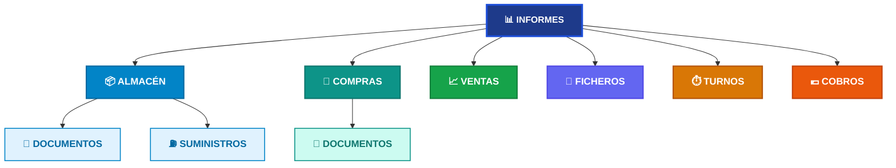

# 🧭 Árbol de Navegación: Módulo de Informes y Gestión Operativa

Este documento define la estructura y arquitectura jerárquica del menú de navegación de **Informes**, diseñado para servir de base escalable a los módulos de reporting, auditoría y análisis de pista de Odoo 17 ERP - UTRECAR.

---

## 📊 Estructura Jerárquica (Mermaid)

---

## 🗂️ Detalle de Secciones y Alcance Funcional

| Sección / Nivel | Submenús Directos | Descripción y Objetivos |
| :--- | :--- | :--- |
| **INFORMES** | - | Nodo raíz de navegación para reportes analíticos, operacionales y fiscales. |
| **📦 ALMACÉN** | `DOCUMENTOS`, `SUMINISTROS` | Control de stock en tanques de combustible, entradas de cisternas, calibraciones/probetas, mermas y suministros de pista por manguera y surtidor. |
| **🛒 COMPRAS** | `DOCUMENTOS` | Registro y fiscalización de albaranes de compra de carburantes (CLH/Exolum, Cepsa, Repsol) y facturas de proveedores de tienda. |
| **📈 VENTAS** | *(Ampliación futura)* | Informes de ventas por estación, empleado, forma de pago (efectivo, tarjeta, crédito, albarán), márgenes y comparativas temporales. |
| **📁 FICHEROS** | *(Ampliación futura)* | Catálogo maestro de entidades exportables (maestro de clientes de crédito, vehículos/matrículas, códigos de surtidores y tarifas). |
| **⏱️ TURNOS** | *(Ampliación futura)* | Informes oficiales de arqueo, cierre de sesión (`pos.session`), cuadre de caja, incidencias, entradas y extracciones por turno y expendedor. |
| **💶 COBROS** | *(Ampliación futura)* | Conciliación de cobros pendientes de pista, deudas por cliente de crédito, cobros diferidos y liquidaciones de cuentas. |

---

## 🚀 Hoja de Ruta para Ampliaciones Futuras
Este árbol se encuentra desacoplado en este documento para incorporar paulatinamente:
- Acciones de menú Odoo (`ir.actions.act_window` / `ir.ui.menu`).
- Filtros por Estación de Servicio (Repsol, Ronda Norte, Vistalegre, Rodalabota, Atenas).
- Permisos por rol (Expendedor vs Encargado vs Administrador).
